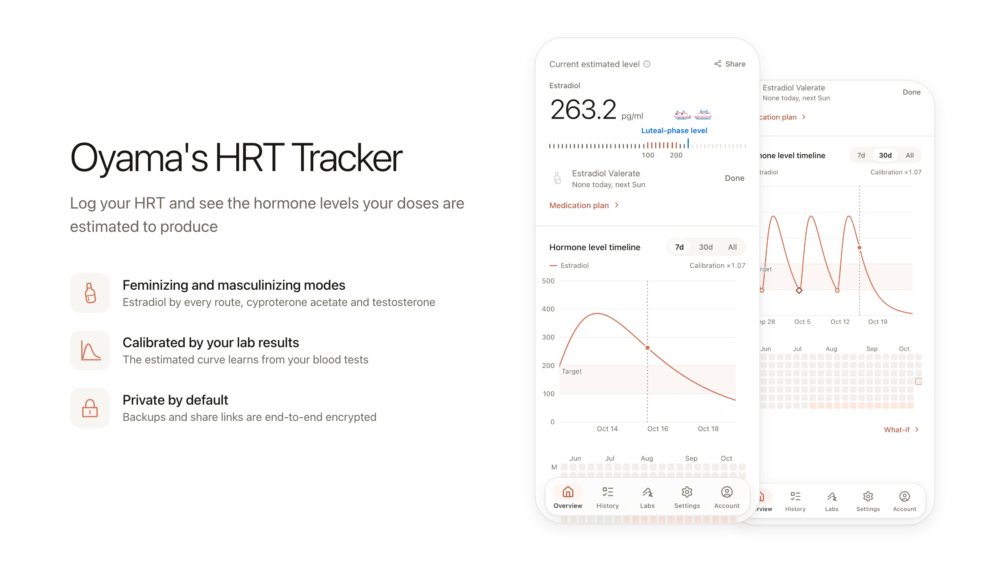
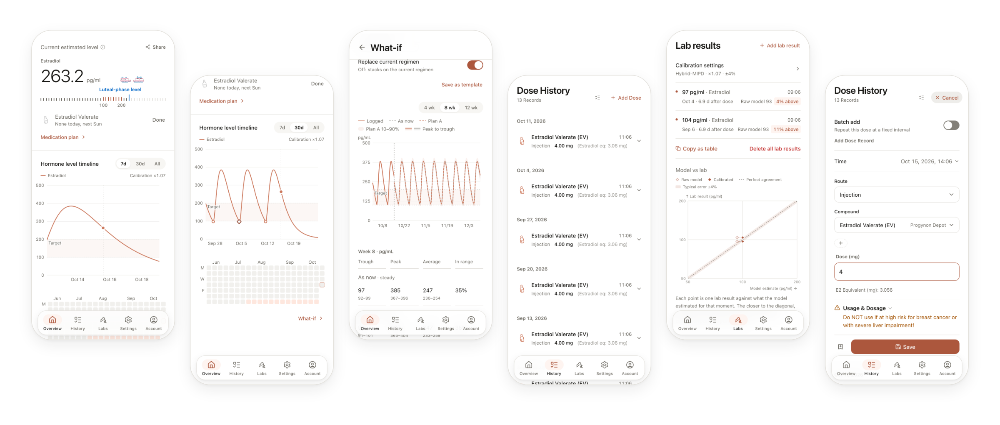

<p align="center">
  <picture>
    <source media="(prefers-color-scheme: dark)" srcset="./docs/images/hero-dark.png" />
    
  </picture>
</p>

<p align="center">
  Log your HRT doses and see the hormone levels they produce. Private, open and free.
  <br />
  记录 HRT 用药，看见它们带来的激素水平。私密、开源、免费。
</p>

<p align="center">
  <a href="https://hrt.mahiro.uk"><b>Open in your browser 在浏览器中打开</b></a>
  &nbsp;&nbsp;&nbsp;
  <a href="https://github.com/xunxunProjects/Oyama-s-HRT-Tracker/releases/latest"><b>macOS and Windows 桌面版</b></a>
  &nbsp;&nbsp;&nbsp;
  <a href="#docker"><b>Self-host with Docker 自行部署</b></a>
</p>

# Table of Contents 目录

- [Introduction 介绍](#introduction-介绍)
- [Features 功能](#features-功能)
  - [Why it is different 有什么不同](#why-it-is-different-有什么不同)
  - [Hormone levels 激素水平](#hormone-levels-激素水平)
  - [Doses and plans 用药与方案](#doses-and-plans-用药与方案)
  - [Lab results 检查结果](#lab-results-检查结果)
  - [Supplies 药量库存](#supplies-药量库存)
  - [Backup and sharing 备份与分享](#backup-and-sharing-备份与分享)
  - [Where the model comes from 模型来源](#where-the-model-comes-from-模型来源)
- [Self-hosting 自行部署](#self-hosting-自行部署)
- [Contributing 参与贡献](#contributing-参与贡献)
- [Support 支持](#support-支持)
- [Legal 法律信息](#legal-法律信息)

# Introduction 介绍

**Oyama's HRT Tracker** is a privacy-focused tool for logging hormone replacement therapy and simulating the hormone levels your doses produce. It has a feminizing mode (estradiol, plus cyproterone acetate) and a masculinizing mode (testosterone), and it can log other adjunct drugs too.

**Oyama's HRT Tracker**（HRT 记录工具）是一个注重隐私的工具，用于记录激素替代疗法用药，并模拟这些剂量带来的激素水平。它提供女性化模式（雌二醇，以及醋酸环丙孕酮）和男性化模式（睾酮），也可以记录其他辅助用药。

**Runs in the browser, as an installable app, on macOS and Windows, or on your own server.**

**可以在浏览器中使用，也可以安装为应用、在 macOS 与 Windows 上运行，或部署到你自己的服务器。**

<p align="center">
  <picture>
    <source media="(prefers-color-scheme: dark)" srcset="./docs/images/gallery-dark.png" />
    
  </picture>
</p>

From left to right: the overview with the current estimate, a month of estradiol levels, the what-if planner, the dose history, lab results next to the model, and logging a new dose. The screenshots use sample records; to make them again, see [design/readme](./design/readme/README.md).

从左到右依次是：当前估算浓度的概览、一个月的雌二醇曲线、方案试算、用药记录、与模型对照的检查结果，以及记录新的剂量。截图使用的是示例数据，重新生成的方法见 [design/readme](./design/readme/README.md)。

> [!WARNING]
> **Not medical advice.** This app shows estimates from a pharmacokinetic model. They can differ a lot from your real hormone levels and are no substitute for blood tests or a clinician. Do not start, stop or change any medication based on this app alone.
>
> **不构成医疗建议。** 本应用展示的是药代动力学模型的估算值，可能与你真实的激素水平相差很大，不能替代抽血检查或医生的判断。请勿仅凭本应用开始、停止或调整任何用药。

# Features 功能

## Why it is different 有什么不同

- **Private by default**: your records stay in your browser unless you turn on cloud backup or make a share link, and both are end-to-end encrypted.\
  **默认私密**：记录保存在你的浏览器里，只有在你开启云备份或创建分享链接时才会上传，而且两者都是端到端加密的。
- **Open source**: every line is public under the MIT License, so anyone can check how the estimates are made.\
  **开源**：全部代码以 MIT 许可公开，任何人都可以查看估算是怎么算出来的。
- **Free**: no subscriptions, no paid features, no ads.\
  **免费**：没有订阅，没有付费功能，也没有广告。
- **Speaks your language**: Simplified Chinese, Traditional Chinese, Cantonese, English, Japanese, Korean and Turkish.\
  **多语言**：简体中文、繁体中文、粤语、英语、日语、韩语和土耳其语。

## Hormone levels 激素水平

- See the estimated level over time: estradiol in pg/mL, cyproterone acetate in ng/mL, total testosterone in ng/dL\
  查看随时间变化的估算浓度：雌二醇 pg/mL、醋酸环丙孕酮 ng/mL、总睾酮 ng/dL
- Estradiol by injection (benzoate, valerate, cypionate, enanthate, and undecylate in beta), oral, sublingual, gel and patch\
  雌二醇支持注射（苯甲酸酯、戊酸酯、环戊丙酸酯、庚酸酯，以及 Beta 阶段的十一酸酯）、口服、舌下、凝胶与贴片
- Testosterone by injection (cypionate, enanthate, undecanoate) and gel\
  睾酮支持注射（环戊丙酸酯、庚酸酯、十一酸酯）与凝胶
- For sublingual doses, pick how long you hold the tablet (2 to 15 minutes) or enter your own time\
  舌下给药时，可以选择含服时间（2 到 15 分钟）或自行填写

## Doses and plans 用药与方案

- Write down what you take and how often; the overview shows what is due today and logs it with one tap\
  记下你使用的药物与频率，概览页会显示今天待用的剂量，一键即可记录
- Compare carrying on as now with a planned change in the what-if view\
  在方案试算中对比维持现状与计划中的调整
- Log spironolactone, bicalutamide, medroxyprogesterone acetate, raloxifene, leuprorelin and triptorelin as well; they have no level model, so they draw no curve\
  也可以记录螺内酯、比卡鲁胺、醋酸甲羟孕酮、雷洛昔芬、亮丙瑞林与曲普瑞林；它们没有浓度模型，因此不会绘制曲线

## Lab results 检查结果

- Log blood test results and see them on the curve next to the estimate\
  记录抽血检查结果，并在曲线上与估算值对照
- Calibrate the estradiol model to you with EKF, OU-Kalman or MIPD, or edit its parameters by hand\
  用 EKF、OU-Kalman 或 MIPD 按你的情况校准雌二醇模型，也可以手动编辑参数

## Supplies 药量库存

- Keep track of how much of each medicine you have\
  记录每种药物的存量
- Logged doses are subtracted automatically, and the overview warns you before you run out\
  记录的用量会自动扣除，快用完时概览页会提前提醒

## Backup and sharing 备份与分享

- Back up to the cloud with end-to-end encryption, or export a file\
  使用端到端加密的云备份，或导出为文件
- Share a read-only link to your dose history and curve; the key lives only in the link, and lab results, weight and account details are never included\
  分享一个只读链接，包含用药记录与曲线；密钥只在链接里，检查结果、体重和账户信息都不会包含在内
- Read the [privacy notice](./PRIVACY.md) ([中文](./PRIVACY.zh-CN.md)) for every detail\
  完整细节见[隐私说明](./PRIVACY.zh-CN.md)（[English](./PRIVACY.md)）

## Where the model comes from 模型来源

The estradiol pharmacokinetic model is based on `PKcore.swift` and `PKparameter.swift` by **@LaoZhong-Mihari**, from the **[HRT-Recorder-PKcomponent-Test](https://github.com/LaoZhong-Mihari/HRT-Recorder-PKcomponent-Test)** repository. Its three-compartment structure, two-part injection depot kinetics and sublingual absorption tiers come from there.

雌二醇的药代动力学模型基于 **@LaoZhong-Mihari** 在 **[HRT-Recorder-PKcomponent-Test](https://github.com/LaoZhong-Mihari/HRT-Recorder-PKcomponent-Test)** 仓库中提供的 `PKcore.swift` 与 `PKparameter.swift`，其中的三室模型、双相肌注库房动力学与舌下吸收分层均来自该仓库。

This project has since adjusted and extended the model: it adds testosterone (injection esters, gel and patch) for the masculinizing mode, cyproterone acetate on its own curve, and estradiol undecylate injections; it revises the gel and sublingual handling; and it can calibrate the estradiol curve against your lab results. See [Algorithm Explanation.md](./Algorithm%20Explanation.md) for the details.

此后本项目对模型做了调整和扩展：为男性化模式加入了睾酮（注射用酯、凝胶与贴片），为醋酸环丙孕酮加入了单独的曲线，并新增了十一酸雌二醇注射；调整了凝胶与舌下给药的处理；还可以用你的检查结果校准雌二醇曲线。详情见 [Algorithm Explanation.md](./Algorithm%20Explanation.md)。

# Self-hosting 自行部署

You are **very welcome** to run this app on your own website or server, and you do not need to ask first. The simplest way is Docker; to use your own Cloudflare account instead, see [Cloudflare](#cloudflare).

我们**非常欢迎**你把这个应用部署到自己的网站或服务器上，无需事先询问。最简单的方式是 Docker；如果想部署到自己的 Cloudflare 账号，请看 [Cloudflare](#cloudflare)。

## Docker

The Docker image runs the complete app locally, including the Worker API, D1
database, and R2-compatible avatar storage. Data is kept in the project's `./data`
directory and survives container restarts. The image is built from source on
your machine, so you need Git and Docker with Compose.

Docker 镜像会在本地运行完整应用，包括 Worker API、D1 数据库和兼容 R2 的头像存储。
数据直接保存在项目目录的 `./data` 中，容器重启不会丢失。镜像会在你的机器上从源码构建，
需要先安装 Git 和带 Compose 的 Docker。

```bash
git clone https://github.com/xunxunProjects/Oyama-s-HRT-Tracker.git
cd Oyama-s-HRT-Tracker
cp .env.docker.example .env
# Replace JWT_SECRET in .env with the output of:
openssl rand -base64 48
mkdir -p ./data
sudo chown 1000:1000 ./data
docker compose up -d --build
```

Then open <http://localhost:8787>. / 然后访问 <http://localhost:8787>。

The first build takes a few minutes. To update later, pull the new code and
rebuild; your data in `./data` is kept:

第一次构建需要几分钟。以后更新时，拉取新代码并重新构建即可，`./data` 中的数据会保留：

```bash
git pull
docker compose up -d --build
```

### Plain http and https 关于 http 与 https

Opening the app over plain http from another device (for example
`http://192.168.1.5:8787`) works, and backups, exports and share links stay
end-to-end encrypted there too. Browsers do hold back a few features until the
page is served over https (or opened as `localhost`): installing it as an app,
offline use, and passkey sign-in. To get those, put the container behind any
https reverse proxy, such as [Caddy](https://caddyserver.com/docs/quick-starts/reverse-proxy)
(`caddy reverse-proxy --from your.domain --to localhost:8787`) or
[Tailscale Serve](https://tailscale.com/kb/1312/serve).

在其他设备上通过 http 访问（例如 `http://192.168.1.5:8787`）也能正常使用，备份、导出和分享链接
依然是端到端加密的。不过浏览器只在 https（或 `localhost`）下开放少数功能：安装为应用、离线使用和
通行密钥登录。需要这些功能时，可以在容器前面加一个 https 反向代理，例如
[Caddy](https://caddyserver.com/docs/quick-starts/reverse-proxy)
（`caddy reverse-proxy --from 你的域名 --to localhost:8787`）或
[Tailscale Serve](https://tailscale.com/kb/1312/serve)。

### Database schema 数据库结构

The schema is defined only by the files in `migrations/`. The container applies
them on every start, and a volume created by an older image is reconciled first
(`docker/reconcile.mjs`), so upgrading needs nothing from you.

数据库结构只由 `migrations/` 目录定义。容器每次启动都会自动应用迁移；旧版镜像创建的
数据卷会先经过 `docker/reconcile.mjs` 对账，升级无需手动操作。

For a Cloudflare deployment, run the same two steps once before deploying a
build that includes migration `0000`:

在 Cloudflare 上部署时，第一次部署包含 `0000` 迁移的版本之前，先执行一次这两步：

```bash
npm run wrangler:migrate:reconcile
npm run wrangler:migrate:remote
```

Web and Docker builds use same-origin `/api` requests by default. Desktop and
other custom-protocol builds should set `VITE_API_ORIGIN` to their Worker/API
origin at build time; the release workflow supplies the hosted origin.

To stop the app without deleting its data: / 停止应用但保留数据：

```bash
docker compose down
```

Without Compose, build and run the image with plain Docker: / 不使用 Compose 时，可以直接用 Docker 构建并运行：

```bash
docker build -t hrt-tracker:local .
docker run -d --name hrt-tracker \
  -p 8787:8787 \
  --env-file .env \
  -v "$(pwd)/data:/data" \
  hrt-tracker:local
```

`ADMIN_USERNAME` and `ADMIN_PASSWORD` are optional. When used, set both. The
container uses Wrangler's local workerd runtime and local persistent D1/R2
resources; it does not connect to the Cloudflare production database or bucket.

`ADMIN_USERNAME` 与 `ADMIN_PASSWORD` 是可选项；如需管理员账号，请同时设置。
容器使用 Wrangler 的本地 workerd 运行时以及本地持久化 D1/R2 资源，不会连接
Cloudflare 生产数据库或存储桶。

The workflow in `.github/workflows/docker-publish.yml` validates pull requests
and publishes `linux/amd64` and `linux/arm64` images to GitHub Container Registry
for `main`, version tags, and manual runs. That package is private for now, so
pulling it without access fails; build from source as shown above.

`.github/workflows/docker-publish.yml` 会在 PR 中验证构建，并在 `main`、版本标签或
手动运行时向 GitHub Container Registry 发布 `linux/amd64` 与 `linux/arm64` 镜像。
该镜像包目前是私有的，没有权限时无法拉取，请按上面的步骤从源码构建。

## Cloudflare

`wrangler.toml` points at the maintainer's own database and bucket. Those IDs
only work inside the maintainer's Cloudflare account, so replace them with
resources you create in yours. Everything below runs from your clone of the
repository.

`wrangler.toml` 里写的是维护者自己的数据库和存储桶，这些 ID 只在维护者的 Cloudflare
账号里有效，所以需要换成你在自己账号里创建的资源。下面的命令都在你克隆下来的仓库里运行。

1. **Sign in 登录**

   ```bash
   npm install
   npx wrangler login
   ```

2. **Create the database 创建数据库**

   ```bash
   npx wrangler d1 create hrt-tracker-prod
   ```

   Copy the `database_id` it prints into the `[[d1_databases]]` block of
   `wrangler.toml`, replacing the one there. Keep the name `hrt-tracker-prod`:
   the npm scripts below use it.

   把命令输出的 `database_id` 填进 `wrangler.toml` 的 `[[d1_databases]]` 中，替换原来的值。
   请保留 `hrt-tracker-prod` 这个名字，下面的 npm 脚本会用到它。

3. **Create the avatar bucket 创建头像存储桶**

   ```bash
   npx wrangler r2 bucket create hrt-tracker-avatars
   ```

   Set `bucket_name` in the `[[r2_buckets]]` block to `hrt-tracker-avatars`
   (or whatever name you chose). R2 has to be enabled once in the Cloudflare
   dashboard before the first bucket can be created.

   把 `[[r2_buckets]]` 中的 `bucket_name` 改成 `hrt-tracker-avatars`（或你取的名字）。第一次创建
   存储桶之前，需要先在 Cloudflare 控制台里开通一次 R2。

4. **Remove the preview blocks 删除预览配置**

   Delete every `[[previews.*]]` block at the end of `wrangler.toml`. They point
   at the maintainer's preview database and are only used by pull request
   previews in Workers Builds. If you want previews too, create a second
   database and bucket and put their names and ID there instead.

   删除 `wrangler.toml` 末尾所有 `[[previews.*]]` 开头的配置。它们指向维护者的预览数据库，
   只给 Workers Builds 的拉取请求预览使用。如果你也需要预览，可以再建一个数据库和存储桶，把它们的
   名字和 ID 填在那里。

5. **Create the tables 创建数据表**

   ```bash
   npm run wrangler:migrate:remote
   ```

   Run this again after pulling updates that add files to `migrations/`.

   以后拉取的更新如果在 `migrations/` 里加了新文件，请再运行一次。

6. **Deploy 部署**

   ```bash
   npm run build
   npx wrangler deploy
   ```

   Wrangler prints a `workers.dev` address. To use your own domain, add it under
   the Worker's Settings, Domains & Routes in the Cloudflare dashboard. If share
   links should use a different address than the one people open, set the
   variable `PUBLIC_APP_ORIGIN` (for example `https://hrt.example.com`).

   Wrangler 会输出一个 `workers.dev` 地址。想使用自己的域名，可以在 Cloudflare 控制台的 Worker
   设置里的 Domains & Routes 添加。如果分享链接需要使用与访问地址不同的域名，可以设置变量
   `PUBLIC_APP_ORIGIN`（例如 `https://hrt.example.com`）。

7. **Set the secrets 设置密钥**

   Sign-in needs `JWT_SECRET`, so set it right after the first deploy.

   登录功能需要 `JWT_SECRET`，请在第一次部署后马上设置。

   ```bash
   openssl rand -base64 48 | npx wrangler secret put JWT_SECRET
   # Optional built-in admin account, set both or neither
   # 可选的内置管理员账号，要么都设置，要么都不设置
   npx wrangler secret put ADMIN_USERNAME
   npx wrangler secret put ADMIN_PASSWORD
   ```

To deploy on every push instead, connect your fork in the Worker's Settings,
Builds, with build command `npm run build` and deploy command
`npx wrangler deploy`, after committing the `wrangler.toml` changes above to
your fork.

如果希望每次推送都自动部署，先把上面对 `wrangler.toml` 的修改提交到你的分叉仓库，再在 Worker
设置的 Builds 里连接仓库，构建命令填 `npm run build`，部署命令填 `npx wrangler deploy`。

## Attribution 署名要求

If you deploy this app publicly, please: / 如果你将该应用公开部署，请：

1. **Keep the original algorithm credits**: Visibly link back to the [HRT-Recorder-PKcomponent-Test](https://github.com/LaoZhong-Mihari/HRT-Recorder-PKcomponent-Test) repository.

   **保留原始算法的鸣谢信息**：在显眼位置添加指向 [HRT-Recorder-PKcomponent-Test](https://github.com/LaoZhong-Mihari/HRT-Recorder-PKcomponent-Test) 仓库的链接。

2. **Respect the license**: Ensure you follow any licensing terms associated with the original algorithm code.

   **遵守许可协议**：确保你遵循原始算法代码所适用的全部许可条款。

# Contributing 参与贡献

Contributions are welcome, and you do not need to be a programmer to help. See [CONTRIBUTING.md](./CONTRIBUTING.md) for running the app locally, a map of the code, adding a translation and making a release, and please follow the [Code of Conduct](./CODE_OF_CONDUCT.md). To report a security problem, see [SECURITY.md](./SECURITY.md).

欢迎参与贡献，不会写代码也一样可以帮忙。本地运行、代码结构、新增翻译与发布新版本的方法见 [CONTRIBUTING.md](./CONTRIBUTING.md)，请遵守[行为准则](./CODE_OF_CONDUCT.md)。报告安全问题请参阅 [SECURITY.md](./SECURITY.md)。

# Support 支持

<p align="center">
  <b>Maintainer 维护者</b>
  <br />
  <a href="https://github.com/SmirnovaOyama">@SmirnovaOyama</a>
  <br />
  <br />
  <b>Original model 原始模型</b>
  <br />
  <a href="https://github.com/LaoZhong-Mihari">@LaoZhong-Mihari</a>
  <br />
  <br />
  <b><a href="https://github.com/xunxunProjects/Oyama-s-HRT-Tracker/graphs/contributors">Contributors 贡献者</a></b>
  <br />
  <br />
  <a href="https://github.com/xunxunProjects/Oyama-s-HRT-Tracker/graphs/contributors">
    
  </a>
</p>

Found a bug or have an idea? [Open an issue](https://github.com/xunxunProjects/Oyama-s-HRT-Tracker/issues/new/choose).

发现问题或有新想法？欢迎[提交 issue](https://github.com/xunxunProjects/Oyama-s-HRT-Tracker/issues/new/choose)。

Wishing steady progress and good health to everyone who uses this tool.

# Legal 法律信息

**Oyama's HRT Tracker is for information only and is not medical advice. Its estimates come from a model and can be far from your real levels. Use it at your own risk, and talk to a clinician about any change to your treatment.**

**Oyama's HRT Tracker 仅供参考，不构成医疗建议。估算值来自模型，可能与你真实的激素水平相差很大。使用风险由你自行承担，任何治疗调整请先咨询医生。**

This project is released under the MIT License; see [LICENSE](./LICENSE). How your data is handled is described in the [privacy notice](./PRIVACY.md) ([中文](./PRIVACY.zh-CN.md)).

本项目遵守 MIT License，详见 [LICENSE](./LICENSE)。数据的处理方式见[隐私说明](./PRIVACY.zh-CN.md)（[English](./PRIVACY.md)）。
