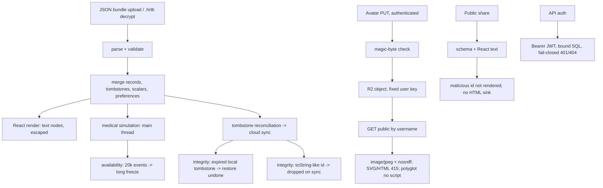

# Local Security Pentest Report

**Status:** local synthetic pentest, not an independent security audit and not
a production approval. Absence of a finding here does not mean "no
vulnerabilities".

**Date:** 2026-10-19
**Target:** Website `agent/add-gpg-website` @
`e6b2e4f5b2cacf84dd9d86bee28d357d80311721`, local Miniflare/Workerd
**Tools reference:** `Recovery/Tools` @
`7ee628b6455dee31ca044e453dff31e6d17a7e56`

## Scope and method

- Local `wrangler dev --local` with an isolated D1 persistence directory and
  all migrations `0000`–`0008`.
- A synthetic `JWT_SECRET`; two synthetic users (`synthetic-a`,
  `synthetic-b`); synthetic records only.
- HTTP probes with `curl`; browser probes with Playwright/Chromium; data-layer
  probes with Vitest.
- No production Cloudflare, D1, R2, TLS, WAF, or real user data was used.
- The website code was not modified for the pentest.

## Findings

### F1 — JSON import can freeze the main thread (Medium, availability)

The complete-backup importer accepts up to `20,000` events per category. The
medical simulation runs synchronously on the main thread; measured on Node 22
(V8) with synthetic events:

| Events | `runSimulation` |
| -----: | --------------: |
|  1,000 |          546 ms |
|  5,000 |        2,788 ms |
| 10,000 |        6,543 ms |

A crafted bundle with 20,000 events can therefore block the UI for roughly
10–15 seconds after import, and the import path itself does not require
authentication. The model is medically unchanged; this is a client-side
denial-of-service chain, not code execution.

Attack chain:

```text
attacker JSON bundle -> import -> events state -> Overview/Forecast simulation
                     -> main-thread block -> UI unresponsive
```

Recommended mitigation: run the unchanged medical simulation in a Web Worker,
and/or lower the import cap or require confirmation for very large imports.
The medical calculation itself should not be changed.

### F2 — Expired local tombstone can undo a restored record on the next sync (Medium/Low, integrity)

The importer prunes an expired local tombstone before its resurrection check,
so an older record is restored. If no incoming tombstone is retained, however,
`writeNeeded` stays false and the expired tombstone is not removed from
`localStorage`. The next cloud merge reads that stale tombstone and removes the
restored record again.

Reproduced at the data layer:

```text
local tombstone x = now - 180d - 1
bundle record x    = now - 180d - 2
import             -> x appears in events
                   -> hrt-deletions still contains x (no deletions write)
mergeSyncStates    -> stats.removed = 1, x disappears
```

Recommended fix: set `writeNeeded` when local tombstones were pruned (for
example `droppedLocal.length > 0`), or TTL-prune tombstones in
`syncMerge`/`normalizeSyncState` on read. Add a regression test that imports a
record over an expired tombstone and then runs a sync merge.

### F3 — Prototype-name record IDs can be accepted then dropped by sync (Low, integrity)

`FORBIDDEN_IDS` rejects `__proto__`, `constructor`, and `prototype`, but not
`toString`, `valueOf`, and other `Object.prototype` names. The importer accepts
a record with such an ID; `syncMerge` uses plain-object lookups
(`tombstones[id] !== undefined`, `id in out`), so the inherited value is read as
a tombstone and the record is silently dropped on the next merge.

Recommended fix: reject all `Object.getOwnPropertyNames(Object.prototype)`
IDs, or use `Map`/null-prototype maps/`Object.hasOwn` in `syncMerge`.

### F4 — Avatar PUT has no rate limit (Low, abuse/cost)

Authenticated `PUT /api/user/avatar` accepts up to 5 MiB and overwrites the
same R2 key (`hrt-tracker-user-avatar/<userId>`). Fifteen consecutive uploads
all returned `200`; there was no `429`. Because the key is fixed per user this
does not create unbounded storage, but it allows write amplification and R2
operation cost. Add the same per-user rate limit used by content writes.

### F5 — Cross-user content DELETE returns success without deleting (Low, response semantics)

`DELETE /api/content/<id>` is scoped by `user_id` in SQL, so user B cannot
delete user A's backup. The endpoint nevertheless returns `200
{"message":"Backup deleted"}` when the row is not owned. This is not an
authorization bypass (A's row remains), but the response is misleading and
should be `404`/`403` for a non-owned ID.

### F6 — `/api/transparency` cache policy (Resolved, keep the public cache)

The endpoint returns `Cache-Control: public, max-age=15`. The body is aggregate
counts plus anonymized recent registrations (a four-hex-character UUID prefix
and an hour-rounded timestamp); it contains no username, token, per-user row,
or exact registration moment. **Decision (2026-10-19): keep `public,
max-age=15`.** The response is intentionally public and cacheable; the 15-second
staleness is acceptable, and the cache reduces D1 load for the transparency
page. `AI_WORKFLOW_AND_CONTEXT.md` B-03 was updated to expect this value. This
is a policy decision, not a finding against the current response.

### F7 — PWA service worker serves the SPA shell for top-level avatar URLs (Informational)

A top-level navigation to `/api/user/avatar/<username>` in the PWA-controlled
browser returned the SPA HTML shell, not the avatar response. A same-origin
`fetch` with `Accept: image/*` returned the actual `image/jpeg` object. This is
a service-worker navigation fallback, not an XSS: the shell is the trusted app,
and the image is loaded via ``/fetch. It may confuse direct-link users;
no security impact was demonstrated.

## Tested and not found

| Area                 | Result                                                                                                                                                                                                                                                                        |
| -------------------- | ----------------------------------------------------------------------------------------------------------------------------------------------------------------------------------------------------------------------------------------------------------------------------- |
| XXE                  | No XML parser in the Worker. XML bodies to `/api/register`, `/api/shares`, `/api/content` returned `400 INVALID_REQUEST` (invalid JSON). No entity expansion.                                                                                                                 |
| RCE                  | No `eval`, `new Function`, `child_process`, `exec`, or `spawn` in the worker/client paths tested. Avatar keys are derived from the JWT user ID; content/share IDs are SQL-bound. No file path is taken from the request.                                                      |
| SQL injection        | All inspected D1 statements use bound parameters. SQLi-style content/share/avatar IDs returned `404`.                                                                                                                                                                         |
| Path traversal       | Encoded `../`, `..\\`, and SQLi-style IDs returned `404` for content, shares, and avatar. Avatar GET resolves a username to a user ID, then uses a fixed key prefix.                                                                                                          |
| Stored/reflected XSS | React renders imported/share values as text; no `dangerouslySetInnerHTML`/`innerHTML` in `src/`. A share snapshot with `id` `` rendered no image and left `window.__xss` undefined. A template name with the same payload rendered as text. |
| Avatar XSS           | SVG and HTML bodies returned `415`. A JPEG-magic + HTML polyglot was accepted, but served as `Content-Type: image/jpeg` with `X-Content-Type-Options: nosniff`; no script executed. 6 MiB body returned `413`.                                                                |
| Avatar/authz         | No token and invalid token returned `401`. Each user's PUT/DELETE targets only their own key. B deleting its own avatar left A's avatar `200`.                                                                                                                                |
| Content/share authz  | B's `/api/content` list was empty; B reading A's content returned `404`; A's content remained after B's DELETE. B's `/api/shares` list was empty; B deleting A's share returned `404`.                                                                                        |
| Prototype pollution  | An imported event with `extras: {"__proto__":{"polluted":true}}` was stored, but `({}).polluted` stayed `undefined`.                                                                                                                                                          |
| Credential leakage   | Exported complete backups contain no `auth_token`, `auth_user`, `weak_password`, `login_device_passes`, or `enc_key`; imported storage left `auth_token` absent.                                                                                                              |
| Security headers     | CSP, HSTS, `X-Frame-Options: DENY`, `X-Content-Type-Options: nosniff`, `Permissions-Policy`, and share `Referrer-Policy`/`X-Robots-Tag` were present.                                                                                                                         |
| CORS/CSRF            | API CORS is `Access-Control-Allow-Origin: *` with `Authorization` allowed. Auth is a Bearer token in `localStorage`, not cookies; no cookie-based CSRF path was found.                                                                                                        |
| Body limits          | `/api/content` returned `413` for >2 MiB and `400` for invalid JSON.                                                                                                                                                                                                          |
| Dependencies         | `npm audit` (prod and full) reported `0 vulnerabilities` at the reviewed revision.                                                                                                                                                                                            |

## Attack-chain topology



## Not tested

- Production Cloudflare, D1, R2, TLS, WAF, DDoS protection, and cron jobs.
- Passkey/WebAuthn ceremonies, TOTP/backup-code paths, and session revocation.
- Every rate-limit boundary and storage-cost limit.
- Cross-user access for every endpoint and every role (admin paths were not
  exercised).
- L3 browser end-to-end automation and multi-device cloud conflict behavior.
- Independent OpenPGP cryptographic audit and provenance/replay resistance.
- Windows ACLs, network filesystems, crash residue, and key-material clearing.
- Real user data or production backups.

## Recommended order

1. Run the unchanged medical simulation in a Web Worker; consider a lower
   import cap for the preview/merge path.
2. Fix the expired-local-tombstone sync undo (F2) and prototype-name sync drop
   (F3).
3. Add an avatar PUT rate limit (F4) and make cross-user DELETE return
   `404`/`403` (F5).
4. Decide the `/api/transparency` cache policy (F6).
5. Add L3 browser tests for export, preview, merge, account warning, and
   calibration confirmation.
6. Keep `.hrtb` experimental until signature/provenance and replay handling
   are designed.
